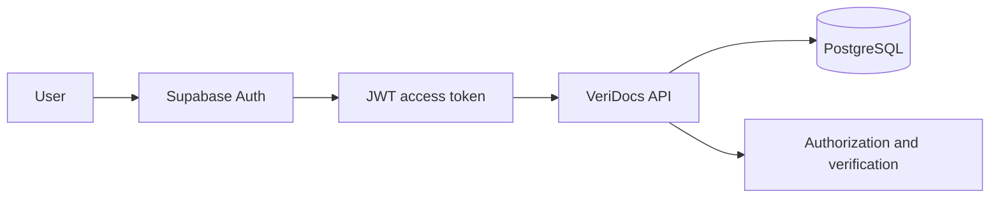

# VeriDocs Architecture

## Authentication Flow

Authenticated routes accept a bearer token or Supabase access-token cookie. The API verifies the token with Supabase Admin, upserts a local `User`, and evaluates the user's active `InstitutionMember` role before mutations.

## Roles

| Role | Permissions |
|---|---|
| `ADMIN` | Manage institution, members, keys, signing, revocation, audit and verification reports |
| `ISSUER` | Sign and revoke documents |
| `AUDITOR` | Read audit and verification reports |
| `VIEWER` | Read institution documents |

Public verification routes do not require authentication.