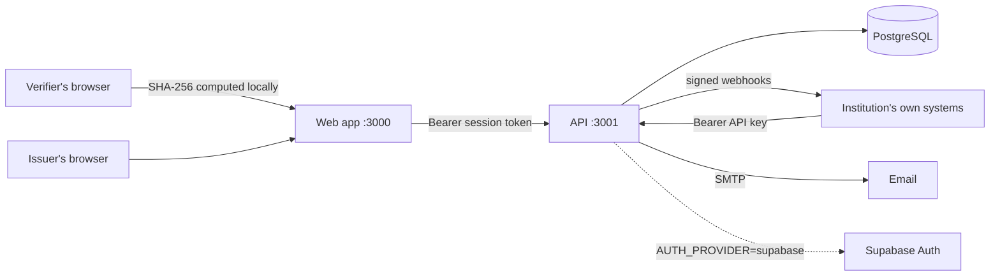
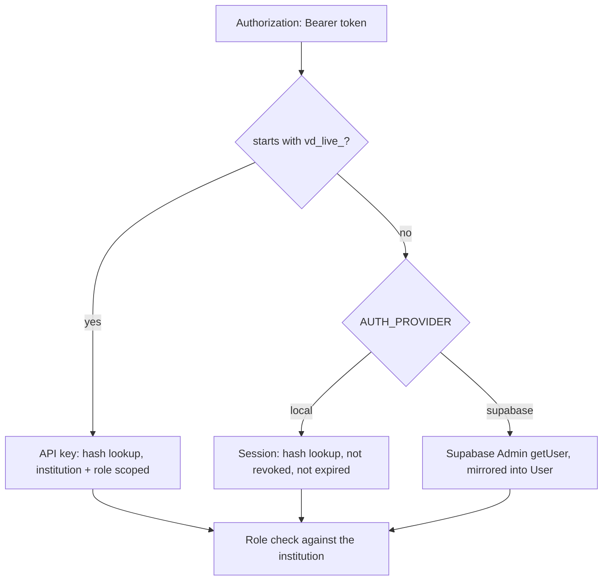

# VeriDocs architecture

## Parts

- **Web app** (`apps/web`, Next.js 16): the public verify pages, sign-in pages and the dashboard. It never touches the database; everything goes through the API.
- **API** (`apps/api`, Next.js 16 route handlers): authentication, authorisation, signing, verification, webhooks, email.
- **Packages**: `crypto` (SHA-256, RSA-SHA256 signing, AES-256-GCM key encryption, PDF stamping, fingerprints; Node's built-in OpenSSL crypto), `database` (Prisma schema, migrations, seed), `shared` (Zod validators and constants used by both apps).

## Signing

1. The PDF is checked (really a PDF, ≤ 10 MB, readable, not already signed by VeriDocs).
2. A document ID is generated and a stamp is drawn on the first page: a QR code to `NEXT_PUBLIC_APP_URL/verify/<id>`, the issuer, the link and the ID.
3. The **final** PDF is hashed (SHA-256), so the file the recipient holds is exactly the one whose fingerprint was signed.
4. The institution's private key is decrypted for this request only, and signs the hex fingerprint (RSA-SHA256, PKCS#1 v1.5).
5. Only the fingerprint, signature and metadata are stored. The PDF is returned and forgotten.
6. The audit trail records it and webhooks hear `document.signed`.

## Verifying

Every route (by ID, by fingerprint, by upload) runs the same assessment:

1. If a file was presented, its fingerprint must equal the stored one, otherwise **ALTERED**.
2. The stored signature must verify against the institution's key (current or earlier), otherwise **FORGED**. This catches a tampered database record.
3. Then **REVOKED**, **EXPIRED**, or **VALID**.

Each check is recorded (with a coarse network and device summary) for the institution's analytics, and webhooks hear `document.verified`.

## Authentication

- **Built-in sign-in** (`local`, the default): scrypt password hashes, random session tokens stored only as SHA-256 hashes (30 days, revocable per device), one-time email links for confirmation and resets.
- **Supabase** (`supabase`): Supabase issues and checks tokens; VeriDocs mirrors each person into its `User` table for memberships and the audit trail.
- **API keys**: for systems, not people. They can sign, revoke and read for their one institution, never manage it.

## Roles

| Role | Can |
|---|---|
| `ADMIN` | Everything: members, keys, API keys, webhooks, settings, signing, records |
| `ISSUER` | Sign and revoke documents; read documents and checks |
| `AUDITOR` | Read documents, checks and the audit trail; export |
| `VIEWER` | Read documents |

Public verification routes need no authentication and are open to any website (CORS `*`); every other route answers only the web app's origin.
